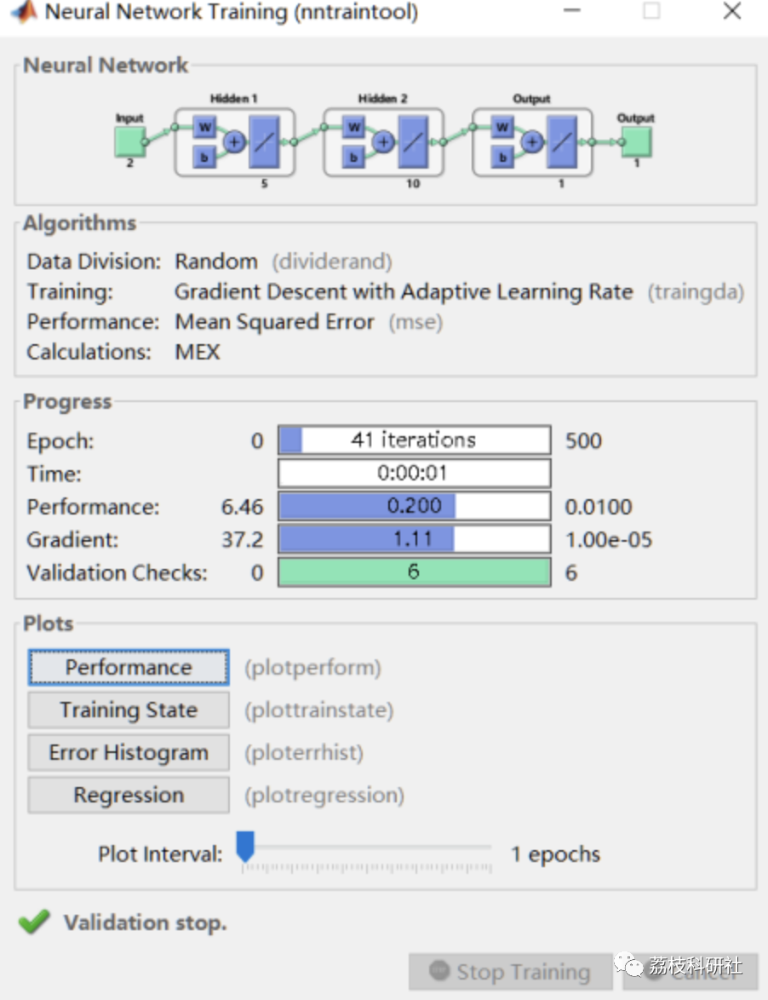
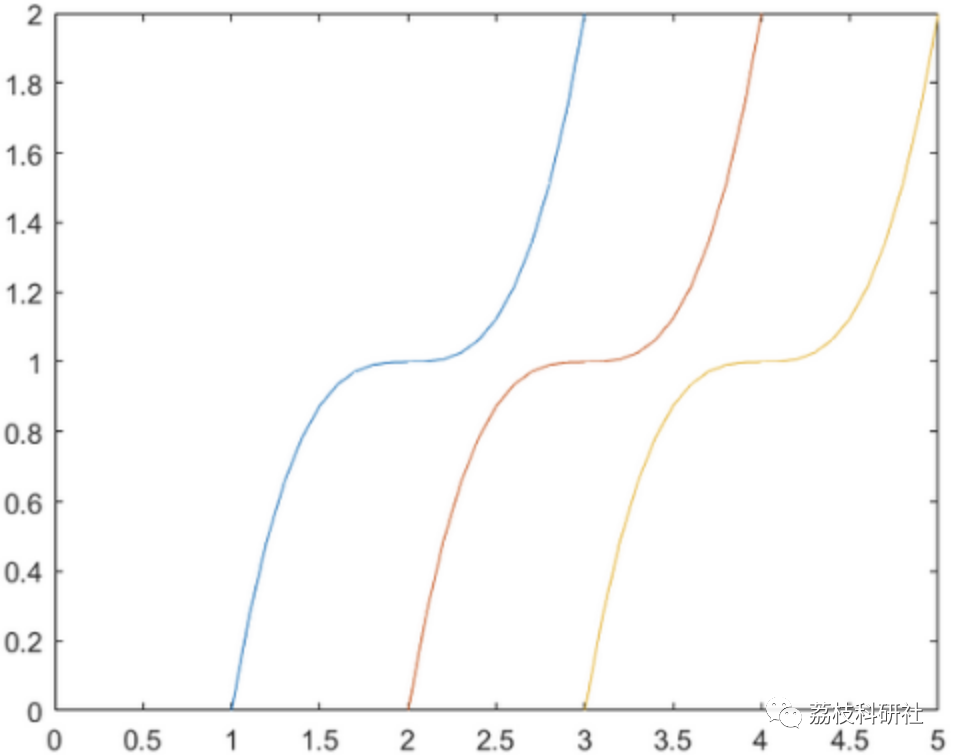
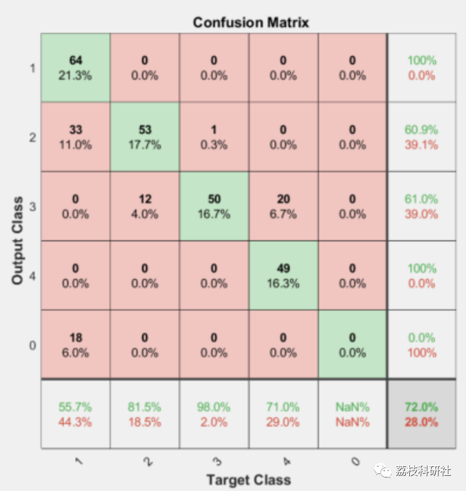

# Best gear judgment for automatic transmission based on BP neural network (Matlab code implementation)

💥💥💥💞💞💞💞 Welcome to this blog❤️❤️❤️💥💥💥
🏆 Bloggers' Advantages: 🌞🌞🌞 The content of the blog strives to be rigorous in thought and clear in logic, for the convenience of readers.
⛳️ Mantra: The journey of a hundred miles is half done in the last ninety.
Litchi Research Society
Code Collection: Power System, Intelligent Algorithms and Applications, Neural Network Prediction, Path Planning, Optimized Scheduling, Workshop Scheduling, Image Processing, Signal Processing...
🎁Column Directory Link:
🌈🌈🌈🌟🌟🌟Intelligent algorithms for electrical code and their application in path planning, neural network prediction optimization scheduling, image processing, workshop scheduling, signal processing, romantic her, my philosophical thoughts, mathematical modeling, complete code matters.  
💥1 Documentation source
📚2 Running Results
🎉3 Parameter Settings
🌈4 Matlab code implementation
💥1 Documentation source
📚2 Running Results
Set the output signals of 1, 2, 3, and 4 to be digital 1. The range of [0,5] for these output signals. Set the range of alpha to [0.2]. Create a neural network with two hidden layers. The number of neurons in the first hidden layer is set to 5, and the number of neurons in the second hidden layer is set to 10. The training function (learning rule) is set to trainda. All activation functions in all hidden layers and the output layer are set to purelin. Each iteration consists of 50 times, with a maximum of 500 iterations. The desired target error is set to 0.01. After training, the neural network is saved as net.mat. From the matrix [10.5]×[0.2], randomly select 500 points and their corresponding values as sample attributes. Then, use the function fun.m to calculate the corresponding target values. These sample points are used to train the neural network.
🎉3 Part of the code
% Network parameter settings\nnet.layers{1}.transferFcn = 'purelin'; % First hidden layer activation function\nnet.layers{2}.transferFcn='purelin';% Second Hidden Layer Activation Function\nnet.layers{3}.transferFcn = 'purelin'; % Activation function of the output layer\nnet.trainparam.show = 50; % 50 times per loop\nnet.trainParam.epochs = 500; % Maximum loop 500 times\nnet.trainparam.goal = 0.01; % Expected target error minimum value\n🌈4 MatlabCode implementation  
Click the "Read More" button at the bottom left of the article.

## Images

<!-- PAYMENT_BLOCK -->

## Get this dataset

- Payment link (Stripe): [Buy now](https://buy.stripe.com/3cs8yP7sY87d0vu9AB)
- Payment QR code: 

<!-- /PAYMENT_BLOCK -->
